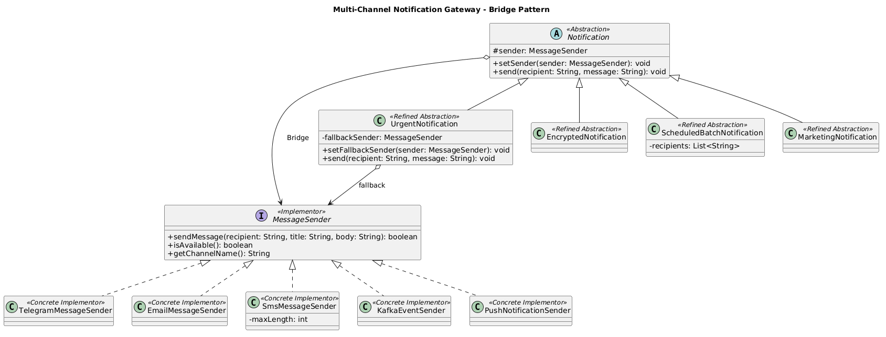

# Assignment 3 — Multi-Channel Notification Gateway

**Course:** Software Design Patterns  
**Design Pattern:** Bridge

## Project Description

This project implements a notification gateway using the Bridge Pattern. It separates notification types from message delivery providers, so both can be changed independently.

## Notification Types

- UrgentNotification — adds an urgent prefix and supports fallback.
- EncryptedNotification — encodes messages using Base64.
- ScheduledBatchNotification — sends messages to multiple recipients and prints a summary.
- MarketingNotification — sends promotional messages.

## Message Providers

- TelegramMessageSender
- EmailMessageSender
- SmsMessageSender
- KafkaEventSender
- PushNotificationSender

All providers are simulated. No external APIs are used.

## Bridge Pattern — Defense Questions

**1. What are the two independent dimensions?**

Notification types and message delivery providers.

**2. Where exactly is the Bridge?**

The Bridge is the `MessageSender sender` field inside the abstract `Notification` class. Notification delegates message delivery to the MessageSender interface.

**3. Why is inheritance problematic here?**

Without Bridge, we would need a separate class for every combination of notification type and provider. This creates too many classes.

**4. What happens when a new provider is added?**

We create a new class implementing MessageSender. Existing Notification classes do not need modification.

**5. What happens when a new Notification type is added?**

We create a new class extending Notification. Existing MessageSender implementations do not need modification.

**6. Why is this Bridge rather than Adapter?**

Bridge separates two independent hierarchies from the beginning. Adapter connects interfaces that are already incompatible.

## Demonstration

The Main class demonstrates six scenarios:

1. Urgent + Telegram
2. Encrypted + Email
3. Batch + SMS
4. Runtime switching from Telegram to Email
5. Telegram unavailable → SMS fallback
6. Marketing + Push

## Unit Tests

The project contains 12 JUnit 5 tests covering successful delivery, provider unavailability, fallback, SMS length restrictions, encryption, batch delivery, runtime switching, new extensions and failure scenarios.

## UML Class Diagram

The UML diagram shows the Notification abstraction, refined notification types, MessageSender interface, concrete providers and their Bridge relationship.

